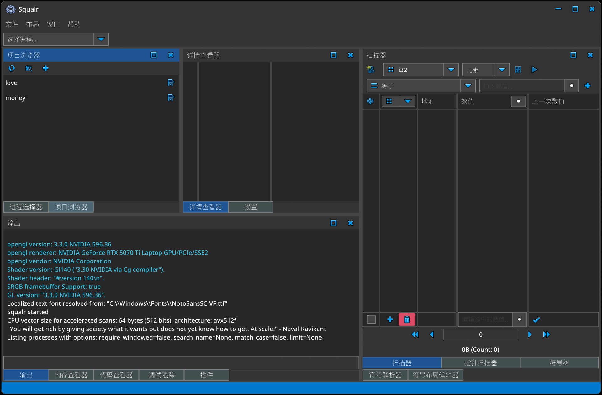

# Squalr

[](http://www.gnu.org/licenses/gpl-3.0)

**简体中文** | [English](README.en.md)

[Squalr 官方网站](https://www.squalr.com)

加入我们的 [Discord 频道](https://discord.gg/Pq2msTx)

**Squalr** 是一款用 Rust 编写的、性能极高的动态分析（逆向工程）工具。

首先，Squalr 是一个快得离谱的内存扫描器，可以搜索并修改正在运行的进程内存。高速扫描通过多线程结合 SIMD 实现，能在几秒内扫完数 GB 的数据。所有 CPU 都能运行，但要获得最佳性能，你的 CPU 需要支持 SSE、AVX 或 AVX-512。

与大多数逆向工程工具不同，动态分析在 Squalr 中是一等公民。这使得一些用其他方式根本无法实现的工作流成为可能——你可以分析程序随时间推移的行为。



----------------------

## 简体中文汉化版（本仓库）

本仓库在官方代码基础上完成了桌面 GUI 的简体中文汉化，可直接构建出中文版 Windows 程序。

- 界面汉化：窗口标题、菜单、工具栏、右键菜单、按钮、标签、提示、占位符、确认对话框，以及扫描比较类型、显示格式等界面文案。
- 中文字体回退：启动时自动定位系统中文字体（Windows 的微软雅黑/黑体/等线/思源黑体、macOS 的苹方、Linux 的 Noto CJK 等）；也可以在 `squalr.exe` 同级 `fonts` 目录放置自定义字体。
- 保持英文的部分：引擎与插件日志、数据类型标识（`i32`、`u64`、`i_x64` 等）、窗口与动作标识、工程文件格式。
- 已移除应用内自动更新：启动时不再查询上游 GitHub release，也不会下载并替换自身二进制。上游的更新包是英文版，若保留自动更新会在上游发新版本时把中文版覆盖掉。请通过本仓库的 Releases 手动获取中文版更新。

构建与打包：

```text
cargo build -p squalr --release
python ./scripts/package_windows_release.py
```

打包产物位于 `dist/`（可运行目录 + zip 压缩包）。

中文文档：

- [Squalr 中文版使用教程](docs/zh-CN/Squalr中文版使用教程.md)（同目录另有 `.docx` 版本）
- [汉化工具与术语表](scripts/localization/README.md)

----------------------

Squalr 是 Squalr-Sharp 的精神续作。想找旧的 C# 仓库？见 [Squalr-Sharp](https://github.com/Squalr/Squalr-Sharp)。注意 Squalr-Sharp 已不再维护，Squalr 才是当前的重心。

本项目与团队成员过去、现在或未来的任何雇主均无关联。

## 使用方式

Squalr 既可以作为桌面应用、终端工具、Android 应用来使用，也可以作为 Rust crate 嵌入你自己的扫描工作流。

### 独立应用
当你需要完整的交互式工作流时使用它：进程选择、元素扫描、数组/字符串扫描、指针扫描、内存查看器、项目文件、符号布局，以及插件驱动的工具链。

| 平台   | GUI   | CLI   | TUI   | 远程（宿主）   | 远程（Shell）   |
| ------ | ----- | ----- | ----- | -------------- | --------------- |
| Windows    | ✅    | ✅    | ✅    | ✅              | ✅               |
| Linux    | ✅    | ✅    | ✅    | ✅              | ✅               |
| Mac    | ✅    | ✅    | ✅    | ✅              | ✅               |
| Android（已 Root）   | ✅    | ✅    | ✅    | ❌              | ✅               |
| iPhone（暂不可用）     | ✅    | ✅    | ✅     | ❌              | ✅               |

### 插件与扩展
插件是扩展 Squalr 行为的既定途径。现有插件 crate 覆盖内置插件、24 位数据类型、指令提供者、二进制符号以及 Dolphin 内存视图路由。中期目标是让插件无需改动核心应用，就能扩展数据类型、项目条目类型、虚拟模块、中间件与工具。

脚本化已在规划中，但目前还没有稳定的公开脚本接口。

### 以库的形式使用 Squalr
当你想要嵌入 Squalr 的某些部分而不是运行它的某个前端时，直接使用这些 crate。按你希望 Squalr 接管多少工作流来选择层次。

| 使用方 | 你提供 | Squalr 提供 | Crate 组合 |
| ------ | ------ | ----------- | ---------- |
| 字节扫描器 | 你自己的字节、快照、文件、模拟器转储或抓取到的内存缓冲。 | 扫描方案、数据类型、快照结构、扫描执行与结果过滤器。 | `squalr-engine-api`、`squalr-engine-scanning` |
| 自定义目标集成方 | 你自己的目标实现，例如模拟器、调试器、远程代理、轨迹记录器或沙箱。 | 用于内存映射、读写、模块与目标句柄的稳定目标 trait。 | `squalr-engine-api`、`squalr-engine-targets`、`squalr-engine-scanning` |
| 本机进程扫描器 | 一个你想让 Squalr 枚举、打开、读取、写入并扫描的本地进程。 | 原生 Windows/macOS/Linux/Android 目标访问能力加上扫描器 crate。 | `squalr-engine-api`、`squalr-engine-targets`、`squalr-engine-targets-native`、`squalr-engine-scanning` |
| Squalr 前端或自动化外壳 | 一个 GUI、CLI、TUI、机器人或命令运行器，想要使用 Squalr 的标准工作流。 | 会话状态、命令分发、应用级编排、目标 I/O 协调、扫描、项目与响应。 | `squalr-engine-session`、`squalr-engine` |
| 命令行适配器 | 一个 CLI、REPL、远程 shell 或脚本桥接，想把用户输入的命令行降级为引擎命令。 | 命令语法、别名、帮助/版本处理，以及向共享命令模型的转换。 | `squalr-engine-api` |
| 项目与符号工具链 | 需要读取、写入、检查或转换 Squalr 项目的工具。 | 项目文件、符号目录、布局、定位器与共享数据模型。 | `squalr-engine-api`、`squalr-engine-projects` |

`squalr-engine-api` 是共享模型 crate。它包含其他各层交流所用的公开数据类型：扫描方案、数值、快照、结果、命令、符号与面向项目的结构。

如果你已经自己持有字节数据，就停留在字节扫描器这一层：构造 `SnapshotRegion`，把它们包进 `Snapshot`，然后调用 `ElementScanner::scan_snapshot`。这条路径不需要进程句柄，也不需要原生目标后端。

如果你想扫描真实进程，请把目标 I/O 与扫描当作两个独立阶段：用 `squalr-engine-targets` 做抽象，需要 Squalr 的原生后端时用 `squalr-engine-targets-native`，再把收集到的内存喂给 `squalr-engine-scanning`。

如果你想要完整的 Squalr 应用工作流，请使用会话/命令 crate，而不是自己拼装底层各层。这条路径适合那些希望由 Squalr 统一协调目标访问、扫描、项目与响应的使用方。

## 开发理念
系统级的工作需要系统级的语言。选择 Rust，是因为它能消灭整类 bug，并且非常适合这项任务。

在评估了多个前端框架之后，我们选定了 egui。egui 为我们带来了小体积的二进制、原生的速度、跨平台能力，以及方便地访问应用数据用于显示。

中期来看，Squalr 的目标是借助现代化的插件系统实现可扩展性。不用再把插件解压到稀奇古怪的位置、再在每次发版时手工升级。这意味着一个真正的插件市场，包含大量免费且易于安装的插件。虽然目前还没做到，但 Squalr 在设计时就已经考虑到开发者会希望扩展类型系统、扩展项目系统、注册自定义工具，以及注册中间件以支持扫描模拟器内存或其他冷门用例。

此外，我们很快会希望支持脚本化。我们还没有决定用哪门语言。虽然多数人第一反应是 Lua 或 Python，但这些语言缺少健壮的数据类型，导致出现尴尬的变通做法。因此，我们还不确定要改用什么，甚至不确定是否存在可行的替代方案。

Squalr 最终会在静态分析领域参与竞争，但不是一开始就这么做。目前 Squalr 刻意不去构建 ASM 到 C++ 的反编译器、代码图，也不做调试器。

长远来看，我们确实希望融入 AI 领域，并且要以真正为用户创造价值的方式融入。以下是我们打算尝试的一些想法：
- 大白话改数据。直接用日常对话告诉智能体你想改什么，由它下发底层命令来完成繁重的工作。这在电子游戏逆向等领域会非常有效。
- 自动发现数据符号。通过分析数值在多次快照间的变化、分析截图等等，我们相信智能体可以帮你建立进程中所有数据和函数的完整地图。
- 低延迟的本地模型。我们希望开发者能够编写机器人，把屏幕数据、内存数据接入，并以足够快的循环运行，从而完成从玩游戏到操作桌面软件的一切事情，而不产生过多延迟。

## 功能特性

### 构建形态
- [X] 桌面 GUI 构建。
- [X] Android GUI 构建。
- [X] CLI 构建。
- [X] TUI 构建。

### 面向开发者的特性
- [ ] 命令/事件钩子
- [ ] 插件系统：数据类型
- [X] 插件系统：中间件（模拟器支持用的过滤器，用自定义逻辑过滤虚拟内存）
- [X] 插件系统：虚拟模块（自定义静态基址——可以是线程栈、特殊的模拟器内存区域等）
- [X] 插件系统：项目条目类型
- [ ] 脚本系统（具体语言待定）

### 面向用户的特性
- [X] 基础扫描
- [X] 数组扫描，包括基础类型数组（即 u8[]、i32[]、string_utf8[]）
- [X] 字符串扫描
- [X] 结构查看器
- [X] 可停靠窗口系统
- [ ] 结构体扫描
- [X] 指针扫描
- [X] 项目系统

## Linux 构建

Linux 构建通过以下入口进行验证：
- `cargo build -p squalr-cli --locked`
- `cargo build -p squalr-tui --locked`
- `cargo build -p squalr --locked`

构建前请安装原生依赖：
- `pkg-config`
- `libasound2-dev`
- `libudev-dev`
- `libxkbcommon-dev`
- `libwayland-dev`
- `libx11-dev`
- `libxcursor-dev`
- `libxi-dev`
- `libxrandr-dev`
- `libxinerama-dev`

## Android 构建

Android 构建目前在 `aarch64-linux-android` 目标、API 级别 30 上进行验证。

### 快速上手：真机安装 APK（特权 GUI 路径）

目标：安装 GUI APK、推送特权 worker，并以有 root 权限的 IPC 模式运行 GUI。

前置条件：
- 已安装 Android SDK 与 NDK。
- 已设置 `ANDROID_HOME`。
- 已设置 `ANDROID_NDK_ROOT`。
- 已安装 Rust Android 目标：`rustup target add aarch64-linux-android`。
- 已安装 Cargo 辅助工具：
  - `cargo install cargo-ndk`
- 已通过 `adb` 连接一台已 Root 的设备。

然后在工作区根目录执行下面任意一条：
- `python ./scripts/build_and_deploy.py`（完整冒烟验证：预检 + 构建 + 安装 + 启动 + IPC worker 检查）
- `python ./scripts/build_and_deploy.py --compile-check`（自动化仅编译路径：预检 + Android Rust 构建 + GameActivity APK 打包，无需设备）
- 仅启动已安装的 APK 而不重新构建：`python ./scripts/run_apk.py`
- 手动运行特权 worker shell 以便调试：`python ./scripts/debug_run_privileged_shell.py`

说明：
- 部署脚本会执行宿主预检（`ANDROID_HOME`、`ANDROID_NDK_ROOT`、目标是否安装，以及 `aarch64-linux-android-clang` 是否可见），然后运行：
  - `cargo ndk --target aarch64-linux-android build -p squalr-cli`
  - `cargo ndk --target aarch64-linux-android build -p squalr`
- GUI APK 作为生成的 Gradle 工程打包在 `target/android-gameactivity-gradle` 下，使用 `androidx.games:games-activity`，这样 Android 软键盘输入状态由 GameActivity 而不是 NativeActivity 处理。
- GUI 通过工作区补丁使用 `third_party/winit-0.30.13` 下的 `winit 0.30.13`。该补丁保留上游的 Android 按键事件处理，把 GameActivity 的文本提交转发到 egui 常规的按键文本路径，在 IME 激活时抑制重复的可打印按键事件，并在每次提交后清空隐藏的 GameActivity 文本缓冲。
- 部署脚本使用 `target/android-gradle` 下固定的本地 Gradle 发行版来完成 GameActivity 打包。如需覆盖，请将 `SQUALR_ANDROID_GRADLE` 设置为兼容的 Gradle 可执行文件。
- 在完整冒烟模式下，脚本会安装 APK、推送 `/data/local/tmp/squalr-cli`、执行 `su -c chmod +x`、启动应用，并验证特权 worker 是否启动。
- 不带参数运行时会提示：`Build in release mode? (y/n [default])`。
- 非交互环境应传入 `--release` 或 `--debug` 以避免该提示。
- `--release` 优先使用 release 产物；如果未配置 release 签名（`[package.metadata.android.signing.release]`），APK 构建会自动回退到 debug。
- 如果 `adb install` 因先前安装而失败，请先卸载：
  - `adb uninstall com.squalr.android`

### 无头 HTTP IPC

`squalr-cli` 可以暴露一套 JSON HTTP 控制面，用于自动化和集成测试：

```text
squalr-cli --http-ipc 127.0.0.1:49321
```

在 Android 上以 root 运行，并从宿主转发端口：

```text
adb shell su 0 sh -c "/data/local/tmp/squalr-cli --http-ipc 127.0.0.1:49321"
adb forward tcp:49321 tcp:49321
```

初始端点有：
- `GET /health`
- `POST /command`，请求体为序列化的 `PrivilegedCommand` JSON，返回 `PrivilegedCommandResult`
- `GET /events?after=<event_id>`，用于轮询引擎事件

要通过 HTTP IPC 端到端验证 Android 调试器路径，请运行：

```text
python ./scripts/android_http_debugger_smoke.py
```

该冒烟脚本会构建 release Android 产物、推送一个会对外公布静态计数器地址的原生监视目标进程，通过 HTTP 驱动 `Process.Open` 以及读/写/访问调试跟踪，并验证每次跟踪停止并分离后目标进程仍在持续输出心跳。

常见预检失败示例：
```text
> rustup target list --installed
aarch64-linux-android
wasm32-unknown-unknown
x86_64-pc-windows-msvc
ANDROID_NDK_ROOT is not set.
```
如果出现这段内容，请把 `ANDROID_NDK_ROOT` 设成你的 Android NDK 路径后重试。

## macOS 构建

macOS 构建通过以下入口进行验证：
- `cargo build -p squalr-cli --locked`
- `cargo build -p squalr-tui --locked`
- `cargo build -p squalr --locked`

运行方式：
- CLI：`cargo run -p squalr-cli -- process list -w -l 20`
- TUI：`cargo run -p squalr-tui`
- GUI：`cargo run -p squalr`

### macOS 安全白名单 / 关闭指南

Squalr 在 macOS 上使用 Mach API（`task_for_pid`、`mach_vm_read_overwrite`、`mach_vm_write`）来打开和检查目标进程。如果这些调用被拦截，打开/读取/写入进程都会失败。

要启用它们，必须关闭系统的沙箱安全特性。请注意，这会影响你的整个系统，并让你更容易受到恶意软件侵害！除非你清楚自己在做什么，否则不建议这样做。

- 以恢复模式启动 Mac（关机后按住电源键开机）。
- 从“实用工具”菜单中打开终端。
- 输入 `csrutil disable`
- 按提示重启
- 运行 Squalr 时用提权方式从命令行启动（`sudo ./squalr`、`sudo ./squalr-cli` 或 `sudo ./squalr-tui`）。

这个过程随时可以反向操作，用 `csrutil enable` 撤销安全改动。

## 架构总览

### 命令/响应系统
Squalr 由两部分组成：一个特权接口和一个非特权核心。这天然形成了命令/响应架构，从而获得清晰的关注点分离。共享的命令模型位于 `squalr-engine-api`；命令行解析是 `squalr-engine-api::commands::command_line` 下的一个 API 适配器，负责把 CLI/REPL 风格的输入降级为这些共享命令。

这让我们可以做出多种形态，例如统一的 GUI/CLI/TUI 构建，以及一个可以控制远程 shell 的潜在远程宿主。

### 架构术语表
- **快照（snapshot）** 是对某个进程内所有虚拟内存区域的一次完整查询。它分两趟创建：一趟确定虚拟页地址与大小，另一趟收集数值。
- **快照区域（snapshot region）** 表示一段连续的虚拟内存范围。例如虚拟内存页 0x1000-0x2000、0x2000-0x3000 会合并成一个 0x1000-0x3000 的快照区域，并带有一些内部簿记来跟踪合并过程。合并很重要，它让跨虚拟页扫描变得简单（例如扫描一个可能跨越多个虚拟页的字节数组）。更多细节见 `快照系统` 一节。
- **快照过滤器（snapshot filter）** 表示快照区域上的一个窗口，由扫描实现创建。可以把它看作以范围形式表示的、紧凑的扫描结果集合。
- **扫描结果（scan result）** 是通过快照过滤器索引到快照区域时得到的数值。生成它们相当昂贵，因为需要一些寻址逻辑和字节反序列化，所以由 CLI/GUI 的显示按需创建。
- **元素（element）** 是一个与扫描结果类似、但更泛化的抽象概念，泛指过滤器内的任意数值。它并不作为具体类型存在，但在代码中经常被这样概念性地使用。用例子最好说明：如果在 2000 字节的内存区域上扫描 1 字节的值、对齐为 2 字节，我们预期找到 1000 个元素；如果值是 4 字节，元素数量就变成 997，因为 4 字节的值不能读取到区域边界之外！

### 快照系统
快照系统的设计目标是智能地对进程内存做快照，同时以对扫描最优的方式排列内存。做法是合并相邻的虚拟内存页。例如，如果有 3 段连续的、每段长度 0x2000 的区域，就会得到单个 0x6000 的区域。我们仍然会拆分进程内存读取调用，但会把字节直接读到更大数组的正确下标处。

这有几个好处。首先，扫描不再需要担心边界条件。跨页边界的字节数组扫描可以平凡地支持！

唯一的复杂性在于：如果某次读取内存调用失败，我们需要拆分这个区域，并把未读到的部分视为已废弃（tombstoned）。

另外，快照结果采用“红黑”机制。前两次取快照时必须分配内存，但之后就可以直接复用已有的数组。

一个可能的优化是决定何时拆分快照区域。目前，如果我们有一个 1GB 的快照区域但只有 2 个过滤器（一个在开头、一个在结尾），后续扫描仍然会读取这两个过滤器之间的全部内存。实践中这很少见，现在就解决有点过早，因此暂时保持现状。

### 扫描过滤器系统
扫描结果通过过滤器的概念被发现。这是一种支持同时进行多个不同数据类型的扫描的巧妙方式。拿到快照后，我们可以用许多不同方式解释这些字节。例如，我们既能按 i8、i16、i32、i64 扫描数值 1，也能按 u8、u16、u32、u64、f32、f64 扫描它！我们只需为每种数据类型创建一组新的过滤器。这同样极其适合并行，尤其是在配合 SIMD 友好的扫描实现时。

事实上，整个扫描系统的瓶颈在于数值收集。读取进程内存的耗时远远超过扫描所有数据类型（哪怕以 1 字节对齐扫描）。

此外，过滤器以 Vec 的 Vec（`Vec<Vec<...>>`）形式跟踪，这是一种扫描优化。它让我们可以并行地快速处理每个快照区域（外层 Vec），再把结果收集成每个区域对应的 Vec。这样就避免了日后把信息重组成“更干净”的形式时出现恼人的运行时瓶颈。

### 扫描游程编码器（RLE）
扫描的工作方式基于游程编码算法。这能对扫描结果做极致压缩。绝大多数进程内存都是 0x00，而字节分布严重偏向 0x01、0xFF 等其他常见值。所以，如果我们在地址 0x10000、大小 0x2000 的区域中扫描 0x00 且该区域全是零，就只会得到一条结果：(0x10000, 0x2000)。

更好的是，使用游程编码让我们能极快地丢弃不匹配的结果。例如，按 i32 扫描数值 1 时，大部分内存是 0。当我们做 SIMD 比较时，由于比较几乎都会失败，大多数 SIMD 向量会整体为假，从而允许我们在游程编码器中跳过 SIMD 宽度的块。更棒的是，匹配时也能这么做！如果我们扫描 0，预期会得到大量完整匹配，从而允许我们把 SIMD 宽度的块以正向方式编码。这让我们在扫描上获得极高的吞吐。

另外，对齐之类的特性让我们可以跳过元素、避免碎片化。想象一下，我们在一个 1GB 的巨大区域里按 1 字节扫描 0x00，而该区域内容只是 0x00 与 0xFF 交替，但扫描对齐是 2 字节。你会预期出现大量碎片化的结果，产生相当多的过滤器，但我们可以避免！办法是存储对齐信息。正因如此，我们实际上只用一条结果就覆盖了整个区域！

现在，当我们索引过滤器取回结果时，始终按对齐步进，从而躲开所有那些被忽略的 0xFF 值。

### 扫描结果
扫描结果几乎不带来有意义的空间开销。空间很稀缺，因为我们已经存储了巨大的进程内存快照。因此我们尽可能避免使用额外空间。相反，我们依靠基本的搜索算法来分页提取扫描结果。例如，一次扫描完成后，每个快照区域都会有一批按数据类型组织的快照过滤器，外加对齐等额外数据。我们可以根据数据类型、过滤器大小和对齐推算出扫描结果的数量。这个值缓存在快照过滤器集合里。取回一个扫描结果通过高效的两步算法完成：
1) 线性查找到包含指定数据类型第 n 个结果的快照区域。这可以很快完成，因为每个快照区域都跟踪其过滤器在各数据类型下的结果数量。快照区域数量不足以值得存储额外数据并改为二分查找。线性即可。
2) 线性查找到包含第 n 个结果的窗口。与上面类似，这也很快。

配合分页，这样无需在快照过滤器中存储额外数据就能闪电般快。我们可以在过滤器集合这一层存一些数据，但这也无妨，因为我们预期任意时刻最多只有约 10 个过滤器集合。

// TODO: 目前我们实际上会构造一个堆并做二分查找，试图把多个数据类型的结果合并到同一份结果里。其实更好的做法是省掉这一步，坚持上面那种双重线性查找方案，并把不同数据类型当作结果的不同标签页。也许如果能在保持良好效率的前提下把结果拉链式合并，那是值得的，但我还需要再想想。

### 扫描规则引擎
所有扫描都会被分解成一种中间形式，以便我们选择吞吐最大的最优扫描策略。需要考虑许多因素，比如：
- 被扫描区域的大小，以及它能否放进 512、256 或 128 位的 SIMD 寄存器。
- 数值是否有容差，比如浮点数。
- 数值是否具备可优化的特征。例如：
    - 如果按 i32 扫描数值 0，但对齐是 1 字节，那么实际上我们会把它分解成 u8 == 0 的扫描，并利用游程编码器丢弃所有小于 i32 大小（4 字节）的区域。这对 SIMD 友好得多，因为我们不再需要把 SIMD 寄存器每次移位 1 字节，而是一次加载并比较一大块。
    - 如果扫描 u32 > 0，那么实际上可以把它重述为 u32 != 0，进而分解成上面那条规则，于是可以做 1 字节检查并用 RLE 丢弃！如你所见，许多规则可以串联使用，带来快得多的扫描。
    - 如果扫描像 0x12341234 这样的 4 字节数值，但对齐是 2 字节，把它分解成 2 字节的 0x1234 可以带来显著性能提升。这在内部称为**周期性（periodicity）**。同样，我们使用 RLE 丢弃技巧扔掉小于 4 字节的区域，因为可能会得到少量 2 字节匹配的误报。这再次避免了重叠，而且我们不再需要移动 SIMD 寄存器。

### 扫描实现
内部我们使用上面的规则引擎，为每个待考察的快照过滤器挑选一个扫描器实现。注意扫描作用在快照过滤器上，而不是快照区域上。第一次扫描时，快照过滤器会覆盖整个快照区域。后续扫描中，随着结果被逐步筛小，扫描实现处理的是越来越小的过滤器。

这就是为什么挑选最佳扫描器至关重要。我们有许多实现，例如：
- 单标量元素扫描器：只扫描 1 个元素，对数值做直接的标量比较。
- 迭代标量元素扫描器：逐个元素地扫描数值。当数据块无法放进 SIMD 寄存器时必须使用它。它也被视为黄金标准实现，其他扫描器可以借助“启用影子扫描”设置与它对照评估——如果高级扫描器产出的结果与它不同，就会记录错误。
- 向量扫描器（稀疏）：执行带掩码的 SIMD 扫描，根据对齐跳过中间元素，例如按 8 字节对齐扫描 i32。
- 向量扫描器（对齐）：对完全对齐的数值执行 SIMD 扫描，例如按 1 字节对齐扫描 u8、按 2 字节对齐扫描 i16、按 4 字节对齐扫描 u32 等等。
- 向量扫描器（重叠）：对重叠的数值执行 SIMD 扫描，例如按 2 字节对齐扫描 i32。它通过加载多个向量、对其中一些做移位、再把结果按位或来合并扫描结果。比其他 SIMD 扫描慢，但仍相当快。
- 向量扫描器（重叠周期性）：执行 SIMD 重叠扫描，但按前面提到的周期性优化丢弃低于指定长度的游程。
- Booyer-Moore：使用标量 Booyer-Moore 搜索算法执行任意字节数组扫描。

## 功能清单
- [X] 自定义安装器，以及基于 Git tag 的自动更新。（汉化版已移除应用内自动更新）
- [X] 可停靠窗口系统。
- [X] 面向 GUI 与引擎的依赖注入框架。
- [X] 命令/响应系统，并支持对已 Root 的 Android 设备的 IPC。
- [X] 扫描结果显示。
- [X] 整数扫描。
- [X] 浮点扫描。
- [X] 大端扫描。
- [X] 向量对齐扫描。
- [X] DataValueBox 支持输入扫描数值（支持数组、二进制与十六进制）。
- [X] 稀疏扫描。
- [X] 字节数组扫描。
- [X] 向量化重叠扫描。
- [X] 周期性向量化重叠扫描。
- [X] 遵循命令/响应、IPC 等的设置系统。
- [X] 直接从扫描窗口冻结/删除扫描结果。
- [X] 字符串扫描。
- [X] 健壮的转换框架。
- [X] 为各种字符串编码提供独立数据类型（并移除旧的字符串编码——独立数据类型更干净）。
- [X] 通用数组扫描系统（即扫描浮点数组、整数数组、字符串数组……）
- [X] GUI 中的结构查看器，可以注册一组活跃属性。
- [X] 结构查看器数据类型的显示类型切换。
- [X] 基于字符串编辑/提交结构查看器条目。
- [X] 项目，按文件持久化。可冻结地址。可排序。
- [X] 直接编辑扫描结果（通过结构查看器）。
- [ ] 结构体扫描。
- [ ] 提高转换框架的覆盖度。
- [ ] 更多字符串编码。
- [ ] 属性查看器数据类型的自定义与内置编辑器。
- [X] 直接删除扫描结果。
- [ ] 大小写不敏感的字符串扫描。
- [ ] 浮点数组扫描的容差处理。
- [X] 指针扫描。
- [X] 内存查看器。
- [ ] 掩码字节扫描。
- [ ] 位域扫描。
- [X] 支持新数据类型的插件系统。引擎在设计时已考虑该特性，所以实际上应该相当容易。
- [ ] 支持模拟器中间件的插件系统（即过滤查询到的虚拟内存、重映射虚拟地址空间等）。
- [ ] 支持虚拟模块的插件系统。与上面非常相似，但用于注册伪造的模块，模拟器同样是主要用例。
- [ ] 支持新项目条目类型的插件系统（即支持 .NET 条目或 JRE 条目）。
- [ ] 完成可跟踪任务系统，以支持取消、进度条等。
- [ ] 属性查看器中可注册的编辑器。但不是弹窗式的（为了兼容移动端），而是作为属性编辑器面板上的接管式界面。
- [ ] Git(hub) 集成？

## 未解决的架构难题
- 我们是否应该允许引擎事件钩子？如果以后支持插件，这可能会很有价值。但 lambda 几乎只以 FnOnce 形式存储，以便更容易捕获栈。它也会稍微弄脏命令/响应架构。
- 应该如何允许插件注册自定义窗口？我们可能需要以某种方式暴露受支持的 egui 控件，或者通过某种仅 GUI 可用的 API 暴露。
- 应该如何允许插件为自定义数据类型注册自定义编辑器？挑战与自定义窗口类似。

## 思路草稿（BRAIN DUMP）
项目条目可以在很大程度上做到面向未来：基本就是继承一个基础 trait，用于挂接 get/set 激活，并存储任意键值对。

每个项目只需要它自己关心的一组键（例如对 AddressItem 来说就是地址、任意模块信息等）。

如果要支持在 AddressItem 中存储结构体，就得格外小心：这意味着存的不再真的是一个 DataValue，而是一个 ValuedStruct；在大多数情况下（单值存储）它可能只包含一个 DataValue。它大概是匿名结构体，不过也应该支持已注册的符号。

关键在于，从 UX 角度别让这件事变得令人抓狂。所有数据类型都已在符号注册表中，所以那部分没问题。如果我们只为 address item 存一个符号引用，那基本上能解决除匿名情况之外的所有场景；而匿名情况下，结构体就需要被完整序列化进条目里。有点糟糕。

强迫用户新建结构体类型也不一定坏（还是那句话，人们到底有多经常扫描结构体？）。

这需要再想想，但大概可以推迟到发布后很久再处理。

===

Valued Struct 特别烦人。支持嵌套看起来很奇怪，甚至可能很蠢，但它也许是必要的（基本上就是一个 JSON 编辑器 GUI）。ValuedStructField 感觉和数据值几乎一样，只是多了少量元数据，比如只读，以及对嵌套的支持（这个*也许*可以用 DataValue 自身实现，但那太复杂了）。

此外，DataValueInterpreter 这个概念很扎眼。

我认为我们也许可以砍掉这个概念，直接操作匿名值（Anonymous Value），并让每个 DataType 支持去匿名化（deanonymize）数值以及受支持的解读类型。

那样我们只需要把字符串引用和格式类型传给 DataType，就能拿到 `Result<DataValue>`。甚至可能支持原地更新，以避免反复重新分配一堆数据值。

我认为我们也许还能简化匿名值的工作方式。实际上，它就是一个字符串 + 一个格式 + 一个可选的数组标志。

现在剩下的问题是 DataValue -> 显示字符串，而我们用于显示的只有这个 AnonymousStringValueFormat。DataValue -> AnonymousString 真的正确吗？我们应该把格式bundle进字符串里吗？重新匿名化（re-anonymizing）是存在的吗？而且它大概会映射到一个通用字符串格式类型（即不是十进制，而是模糊处理）。

至少如果我们重新匿名化，就能保留当前的显示格式，转换逻辑可以借此说“实际上把这个匿名字符串当作类型 x，转换成数据值，再转回类型 y 的匿名字符串”。

从理解的角度看，似乎没有真正的坏处。

===

结构体扫描会非常棘手。想象扫描 {float} {float} {float}，即把 XYZ 坐标当作一个结构体。由于浮点容差，你不能简单地序列化成字节再扫描它们。更糟的是，如果你做 X > 2000、Y < 500、Z > 0，这就必须逐字段处理。

我们现有的架构已经相当灵活，但这绝对需要专门的扫描器实现，而且它极不可能受益于规则引擎的任何优化。

---

英文原文见 [README.en.md](README.en.md)。
